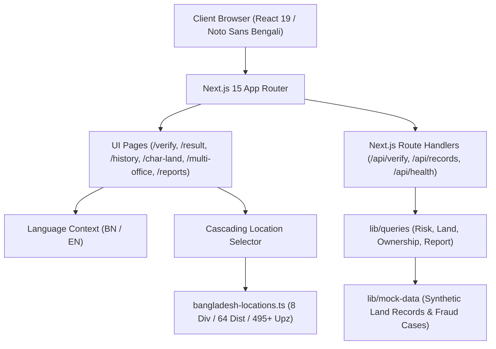

<div align="center">

# 🌿 ভূমিমিত্র — BhumiMitro
### বাংলাদেশ ভূমি রেকর্ড প্রাক-যাচাই ও জালিয়াতি ঝুঁকি মূল্যায়ন সহকারী
**Bangladesh Land Record Pre-Verification & Fraud Risk Decision Support Platform**

[](https://nextjs.org/)
[](https://react.js.org/)
[](https://www.typescriptlang.org/)
[](https://tailwindcss.com/)
[](./data/bangladesh-locations.ts)
[](./lib/translations.ts)

<p align="center">
  <b>জমি কেনার আগে জেনে নিন জমির প্রকৃত অবস্থা ও সম্ভাব্য ঝুঁকি</b><br>
  <i>"Know your land before you buy — an AI-powered intelligence layer for Bangladesh real-estate due diligence."</i>
</p>

[বৈশিষ্ট্যসমূহ](#-মূল-বৈশিষ্ট্যসমূহ--key-features) •
[প্রশাসনিক ডাটাবেজ](#-বাংলাদেশ-প্রশাসনিক-অবস্থান-ডাটাবেজ) •
[আর্কিটেকচার](#-প্রযুক্তি-ও-আর্কিটেকচার) •
[অ্যাপ্লিকেশন রুট](#-অ্যাপ্লিকেশন-রুটসমূহ--application-routes) •
[ইনস্টলেশন ও ব্যবহার](#-ইনস্টলেশন-ও-লোকাল-সেটআপ) •
[আইনি সতর্কতা](#-আইনি-সতর্কতা--legal-disclaimer)

---

</div>

## 📖 সারসংক্ষেপ (Executive Summary)

বাংলাদেশে জমি ক্রয়-বিক্রয় এবং মালিকানা হস্তান্তরের ক্ষেত্রে তথ্যের অসঙ্গতি, ভুয়া খতিয়ান, উত্তরাধিকার গোপন, নদীর চর/খাস জমি দখল এবং সাব-রেজিস্ট্রি ও এসি ল্যান্ড অফিসের ডাটার অমিল একটি বহুল পরিচিত সমস্যা।

**ভূমিমিত্র (BhumiMitro)** হলো একটি স্বয়ংসম্পূর্ণ, দ্বিভাষিক (বাংলা ও ইংরেজি) প্রাক-যাচাই ও সিদ্ধান্ত সমর্থনকারী প্ল্যাটফর্ম (Pre-verification & Decision-Support System)। এটি কোনো জমি কেনার আগে সম্ভাব্য ক্রেতা, ব্যাংক ঋণ মূল্যায়নকারী কিংবা আইনজীবীদের একটি নির্ভরযোগ্য প্রাথমিক যাচাই (Initial Due Diligence) প্রতিবেদন প্রদান করে।

> [!IMPORTANT]
> **ভূমিমিত্র কোনো সরকারি সার্ভার বা ডাটাবেজ পরিবর্তন করে না।** এটি প্রচলিত ভূমি জটিলতা ও ঝুঁকিগুলোকে সিমুলেট করে ব্যবহারকারীকে পরামর্শ দেয়—কোন কোন নথিতে অসঙ্গতি রয়েছে এবং সরকারি অফিসে যাওয়ার আগে কী কী যাচাই করা জরুরি।

---

## ✨ মূল বৈশিষ্ট্যসমূহ (Key Features)

### ১. 🔍 বুদ্ধিমান জমি যাচাই (Smart Land Verification)
- **ক্যাসকেডিং ড্রপডাউন (Cascading Dropdowns):** বিভাগ নির্বাচন করলে স্বয়ংক্রিয়ভাবে সংশ্লিষ্ট জেলা এবং জেলা নির্বাচন করলে সংশ্লিষ্ট উপজেলা তালিকাভুক্ত হয়।
- **ডাইনামিক ওপেনস্ট্রিটম্যাপ (Dynamic OpenStreetMap Integration):** ফর্মে যে বিভাগ বা জেলা বা উপজেলা সিলেক্ট করা হয়, মানচিত্রটি স্বয়ংক্রিয়ভাবে সেই ভৌগোলিক স্থানাঙ্কে (Coordinates) জুম করে রি-সেন্টার হয়।
- **জরিপের ধরন ও দাগ/খতিয়ান অনুসন্ধান:** CS, SA, RS, BS খতিয়ান ও দাগ নম্বরের ভিত্তিতে অনুসন্ধান।

### ২. 🛡️ ফ্রড রিস্ক অ্যাসেসমেন্ট ইঞ্জিন (Fraud Risk Assessment Engine)
- রিয়েল-টাইম ডায়াগনস্টিক ট্রাই-স্টেট স্ট্যাটাস:
  - 🟢 **STRONG (নিরাপদ):** ধারাবাহিক মালিকানা রেকর্ড ও নথির মিল।
  - 🟡 **WEAK (সতর্কতা):** নাম বা পরিমাপের অমিল, দাখিলা বকেয়া বা খারিজ অসম্পূর্ণ।
  - 🔴 **BROKEN (উচ্চ ঝুঁকি):** দ্বৈত মালিকানা দাবি, খাস/ভিপি জমির দাগ অথবা ভুয়া খতিয়ান সন্দেহ।
- সংখ্যাসূচক রিস্ক স্কোর (০ থেকে ১০০) এবং সুনির্দিষ্ট ঝুঁকি ফ্ল্যাগ।

### ৩. 📜 মালিকানার ধারাবাহিকতা ও পিট-দলিল ট্র্যাকার (Chain of Title Genealogy)
- সিএস (CS) থেকে বিএস (BS) পর্যন্ত বিভিন্ন জরিপের মধ্যবর্তী হস্তান্তরের টাইমলাইন।
- ওয়ারিশান সূত্রে প্রাপ্ত জমি, হেবা দলিল, রেজিস্ট্রি বিক্রয় দলিল ও নামজারি (Mutation) রেকর্ডের ধারাবাহিকতা বিশ্লেষণ।

### ৪. 🌊 চর ও নদী সিকস্তি/পয়স্তি রাডার (Char Land & Riverine Risk Radar)
- নদীভাঙন (Diluvion) ও জেগে ওঠা চর (Accretion) জমির আইনি জটিলতা পর্যবেক্ষণ।
- স্টেট অ্যাকুইজিশন অ্যান্ড টেন্যান্সি অ্যাক্ট ১৯৫০ (Section 86/87) এর আলোকে খাস জমি ও ব্যক্তিমালিকানা সীমানা সতর্কবার্তা।

### ৫. 🏢 মাল্টি-অফিস ক্রস-ভেরিফিকেশন ট্র্যাকার (Multi-Office Cross Verification)
- তিনটি প্রধান ভূমি কর্তৃপক্ষের নথিপত্রের তুলনা:
  1. **উপজেলা ভূমি অফিস / এসি ল্যান্ড (AC Land Office):** নামজারি ও জমাভাগ খতিয়ান, ডিসিআর, খাজনা দাখিলা।
  2. **সাব-রেজিস্ট্রি অফিস (Sub-Registry Office):** মূল সাফ-কবলা দলিল, বায়া দলিল ও বালাম বই তল্লাশি।
  3. **ভূমি রেকর্ড ও জরিপ অধিদপ্তর (DLRS):** মুদ্রিত খতিয়ান ও চূড়ান্ত মৌজা নকশা।

### ৬. 📑 প্রিন্ট ও পিডিএফ-রেডি অ্যাডভাইজরি রিপোর্ট (Printable Advisory Reports)
- প্রতিটি পার্সেলের জন্য বিস্তারিত আইনি ঝুঁকি প্রতিবেদন।
- ব্রাউজারের মাধ্যমে সরাসরি এক ক্লিকে অফিশিয়াল এ-ফোর (A4) সাইজে প্রিন্ট বা PDF হিসেবে সংরক্ষণ উপযোগী।

### ৭. 📱 কিউআর কোড স্ক্যানার ও ভেরিফিকেশন (QR Code Verification)
- QR কোডে `https://bhumi-mitro.vercel.app/qr-verify?code=...` লিংক তৈরি হয়; স্ক্যান করলে ডেপ্লয় করা সাইটে রেকর্ড যাচাই পেজ খোলে।
- অন্য ডোমেইনে ডেপ্লয় করলে `NEXT_PUBLIC_APP_URL` এনভায়রনমেন্ট ভ্যারিয়েবল সেট করুন। এটি না থাকলে QR-এ BhumiMitro-এর ডিফল্ট ডেপ্লয়ড URL ব্যবহার হবে।

### ৮. 🌐 সম্পূর্ণ দ্বিভাষিক সমর্থন (Bilingual UI with Noto Sans Bengali)
- সমগ্র অ্যাপ্লিকেশনে গুগল ফন্টসের **Noto Sans Bengali** টাইপোগ্রাফি ব্যবহার করা হয়েছে।
- এক ক্লিকে বাংলা ও ইংরেজি ভাষার মধ্যে তাৎক্ষণিক পরিবর্তন।
- জাতীয় পতাকার গাঢ় সবুজ রঙ (`#006A4E`) সম্বলিত প্রফেশনাল ইউজার ইন্টারফেস।

---

## 🗺️ বাংলাদেশ প্রশাসনিক অবস্থান ডাটাবেজ

ভূমিমিত্রের কেন্দ্রস্থলে রয়েছে বাংলাদেশের সম্পূর্ণ প্রশাসনিক কাঠামোর একটি কেন্দ্রীয় ও স্ট্রাকচার্ড ডাটাবেজ ([`data/bangladesh-locations.ts`](./data/bangladesh-locations.ts)):

| প্রশাসনিক স্তর | সংখ্যা | বিবরণ |
|---|:---:|---|
| **বিভাগ (Divisions)** | **৮টি** | ঢাকা, চট্টগ্রাম, রাজশাহী, খুলনা, বরিশাল, সিলেট, রংপুর, ময়মনসিংহ |
| **জেলা (Districts)** | **৬৪টি** | প্রতিটি জেলা সুনির্দিষ্ট বিভাগ আইডি ও জিপিএস স্থানাঙ্কের সাথে সংযুক্ত |
| **উপজেলা (Upazilas)** | **৪৯৫+ টি** | প্রতিটি উপজেলা সংশ্লিষ্ট জেলা আইডির সাথে ভ্যালিডেট করা |

```
বিভাগ (Division) ──► জেলা (District) ──► উপজেলা (Upazila) ──► মৌজা (Mouza)
```

- **অটো-রিসেট মেকানিজম:** বিভাগ পরিবর্তন করলে জেলা ও উপজেলা স্বয়ংক্রিয়ভাবে রিসেট হয়ে যায়; জেলা পরিবর্তন করলে উপজেলা রিসেট হয়।
- **স্থানাঙ্ক ম্যাপিং:** প্রতিটি প্রশাসনিক ইউনিটের অক্ষাংশ ও দ্রাঘিমাংশ (Latitude/Longitude) সংযুক্ত থাকায় ওপেনস্ট্রিটম্যাপে নির্ভুল ভিজ্যুয়ালাইজেশন নিশ্চিত হয়।

---

## 🏗️ প্রযুক্তি ও আর্কিটেকচার

ভূমিমিত্র সম্পূর্ণ আধুনিক ও প্রোডাকশন-গ্রেড আর্কিটেকচারের উপর নির্মিত:



### ফ্রন্টএন্ড ও কোর টেকনোলজি:
- **ফ্রেমওয়ার্ক:** [Next.js 15.4.9 (App Router)](https://nextjs.org/)
- **লাইব্রেরি:** [React 19.2.1](https://react.js.org/)
- **টাইপ সেফটি:** [TypeScript 5.9.3](https://www.typescriptlang.org/)
- **স্টাইলিং:** [Tailwind CSS 4.1.11](https://tailwindcss.com/)
- **আইকন:** [Lucide React](https://lucide.dev/)
- **অ্যানিমেশন:** [Motion](https://motion.dev/)
- **ম্যাপ ইন্টিগ্রেশন:** OpenStreetMap (OSM) Embed Engine with dynamic bounding-box calculation

---

## 📂 প্রোজেক্ট স্ট্রাকচার (Project Directory)

```text
bhumimitro/
├── app/                              # Next.js 15 App Router Pages & APIs
│   ├── admin/                        # অ্যাডমিন ড্যাশবোর্ড ও অডিট লগ
│   ├── api/                          # সার্ভার রুট হ্যান্ডলার
│   │   ├── health/                   # সিস্টেম হেলথ চেক
│   │   ├── qr-verify/                # কিউআর কোড যাচাই এন্ডপয়েন্ট
│   │   ├── records/                  # রেকর্ড অনুসন্ধান ও বিস্তারিত API
│   │   └── verify/                   # পার্সেল ভেরিফিকেশন API
│   ├── char-land/                    # চর ও নদী সিকস্তি-পয়স্তি রিস্ক রাডার
│   ├── history/                      # মালিকানা পরিবর্তনের ঐতিহাসিক টাইমলাইন
│   │   └── [id]/                     # নির্দিষ্ট জমির বংশলতিকা ও দলিল ইতিহাস
│   ├── multi-office/                 # তিন অফিসের ক্রস-ভেরিফিকেশন ট্র্যাকার
│   ├── qr-verify/                    # কিউআর স্ক্যানার পেজ
│   ├── report/                       # একক পার্সেল আইনি প্রতিবেদন
│   │   └── [id]/
│   ├── reports/                      # সকল সংরক্ষিত প্রতিবেদনের তালিকা
│   ├── result/                       # যাচাই ফলাফল ও ঝুঁকি বিশ্লেষণ ড্যাশবোর্ড
│   │   └── [id]/
│   ├── verify/                       # মূল জমি যাচাই ফর্ম ও ইন্টারেক্টিভ ম্যাপ
│   ├── globals.css                   # গ্লোবাল সিএসএস ও Noto Sans Bengali ফন্ট
│   ├── layout.tsx                    # রুট লেআউট ও ব্যানার/ন্যাভবার
│   └── page.tsx                      # হোম ল্যান্ডিং পেজ
├── components/                       # রিইউজেবল রিয়্যাক্ট কম্পোনেন্ট
│   ├── forms/                        # বাংলাদেশ ক্যাসকেডিং লোকেশন সিলেক্টর
│   ├── AdvisoryDisclaimer.tsx        # আইনি সতর্কতা ডিসক্লেইমার
│   ├── LanguageContext.tsx           # দ্বিভাষিক (BN/EN) স্টেট ম্যানেজার
│   ├── Navbar.tsx                    # রেসপনসিভ ন্যাভিগেশন বার
│   └── Footer.tsx                    # ফুটার কম্পোনেন্ট
├── data/                             # কেন্দ্রীয় ডেটাসেট
│   ├── bangladesh-locations.ts       # ৮ বিভাগ, ৬৪ জেলা, ৪৯৫+ উপজেলার ডাটাবেজ
│   └── demo_records.json             # সিমুলেটেড ল্যান্ড রেকর্ডস
├── lib/                              # বিজনেস লজিক ও কোয়েরি লেয়ার
│   ├── mock-data/                    # বিশদ কৃত্রিম ল্যান্ড ডেটা (দলিল, নামজারি, খাস ইত্যাদি)
│   ├── queries/                      # কোয়েরি ফাংশন (ল্যান্ড, ঝুঁকি, মালিকানা)
│   ├── api.ts                        # ইউনিফাইড ক্লায়েন্ট API ইন্টারফেস
│   ├── translations.ts               # বাংলা ও ইংরেজি শব্দভাণ্ডার
│   └── validation.ts                 # ফর্ম ও অবস্থান ভ্যালিডেশন
├── scripts/                          # অটোমেশন ও টেস্টিং স্ক্রিপ্টস
│   ├── test-locations.ts             # প্রশাসনিক ডাটাবেজের রিলেশন টেস্ট
│   └── test-routes.mjs               # সকল রুটের স্বয়ংক্রিয় স্ট্যাটাস টেস্ট
├── public/                           # স্ট্যাটিক অ্যাসেটস ও ব্যানার ছবি
├── package.json                      # ডিপেন্ডেন্সি ও স্ক্রিপ্ট কনফিগারেশন
└── README.md                         # প্রোজেক্ট পরিচিতি ও গাইড
```

---

## 🚦 অ্যাপ্লিকেশন রুটসমূহ (Application Routes)

| রুট (Route) | মেথড | উদ্দেশ্য |
|---|:---:|---|
| `/` | `GET` | হোম ল্যান্ডিং পেজ, ফিচার পরিচিতি, এফএকিউ এবং কুইক স্টার্ট |
| `/verify` | `GET` | জমি যাচাইকরণ ফর্ম, ক্যাসকেডিং লোকেশন ড্রপডাউন ও লাইভ ম্যাপ |
| `/result/[id]` | `GET` | জমির ঝুঁকি বিশ্লেষণ, স্কোর (STRONG/WEAK/BROKEN) ও অসঙ্গতি |
| `/history` | `GET` | মালিকানা রেকর্ড ও হস্তান্তরের ঐতিহাসিক টাইমলাইন ব্রাউজার |
| `/history/[id]` | `GET` | নির্দিষ্ট খতিয়ানের পূর্ববর্তী মালিকানা ও দলিল পরম্পরা |
| `/char-land` | `GET` | চর জমি, নদী সিকস্তি/পয়স্তি এবং খাস জমি রাডার |
| `/multi-office` | `GET` | এসি ল্যান্ড, সাব-রেজিস্ট্রি এবং জরিপ অধিদপ্তরের ক্রস-চেক |
| `/reports` | `GET` | জেনারেটকৃত সকল আইনি মূল্যায়ন রিপোর্টের তালিকা |
| `/report/[id]` | `GET` | প্রিন্ট ও সংরক্ষণ উপযোগী পূর্ণাঙ্গ অফিসিয়াল রিপোর্ট |
| `/qr-verify` | `GET` | কিউআর কোড স্ক্যানার ও তাৎক্ষণিক পার্সেল অনুসন্ধান |
| `/admin` | `GET` | সিস্টেম অডিট ট্রেইল, রেকর্ড হেলথ ও অ্যাক্টিভিটি মনিটর |
| `/api/verify` | `POST` | জমি অনুসন্ধান ও ঝুঁকি অ্যাসেসমেন্ট ব্যাকএন্ড সার্ভিস |
| `/api/records` | `GET` | রেকর্ড সার্চ ও ফিল্টারিং সার্ভিস |
| `/api/records/[id]` | `GET` | একক রেকর্ডের JSON ডেটা সার্ভিস |
| `/api/qr-verify` | `POST` | ডিজিটাল কিউআর কোড ভ্যালিডেশন এন্ডপয়েন্ট |
| `/api/health` | `GET` | সিস্টেম হেলথ ও সিমুলেটেড ডেটাবেজ স্ট্যাটাস |

---

## 💻 ইনস্টলেশন ও লোকাল সেটআপ

### পূর্বশর্ত:
- **Node.js**: `20.x` বা তার পরবর্তী সংস্করণ
- **npm**: `10.x` বা তার পরবর্তী সংস্করণ

### ১. ক্লোন ও ডিপেন্ডেন্সি ইনস্টলেশন
```bash
git clone https://github.com/your-username/bhumimitro.git
cd bhumimitro
npm install
```

### ২. ডেভেলপমেন্ট সার্ভার চালু করা
```bash
npm run dev
```
ব্রাউজারে **`http://localhost:3000`** ওপেন করুন। কোনো অতিরিক্ত ব্যাকএন্ড বা ডেটাবেজ সেটআপের প্রয়োজন নেই; বিল্ট-ইন সিমুলেশন ডেটাবেজ স্বয়ংক্রিয়ভাবে কার্যকর থাকবে।

### ৩. প্রোডাকশন বিল্ড ও রান
```bash
npm run build
npm start
```

### ৪. টেস্ট ও কোয়ালিটি অডিট
```bash
# ১. প্রশাসনিক ডাটাবেজ ইন্টিগ্রিটি টেস্ট (৬৪ জেলা ও উপজেলা সম্পর্ক পরীক্ষা)
npm run test:locations

# ২. টাইপস্ক্রিপ্ট কম্পাইলেশন ভেরিফিকেশন
npx tsc --noEmit

# ৩. ইএসলিন্ট (ESLint) কোড কোয়ালিটি টেস্ট
npm run lint

# ৪. সকল ১৬টি রুটের স্বয়ংক্রিয় এন্ড-টু-এন্ড টেস্ট
node scripts/test-routes.mjs
```

---

## 🧪 ডেমো সিনারিও ও নমুনা রেকর্ডসমূহ

ভূমিমিত্রের কৃত্রিম ডেটাবেজে বাস্তবসম্মত বিভিন্ন পরিস্থিতি সিমুলেট করার জন্য নিম্নলিখিত নমুনা রেকর্ডগুলো অন্তর্ভুক্ত রয়েছে:

| রেকর্ড আইডি | জেলা ও উপজেলা | মৌজা ও জরিপ | মূল পরিস্থিতি / প্রত্যাশিত ফলাফল |
|---|---|---|---|
| `BM-DEMO-001` | ঢাকা, সাভার | সেনপাড়া পর্বতা, RS | 🟢 **STRONG**: খতিয়ান ও নামজারি সম্পূর্ণ বৈধ, কোনো অসঙ্গতি নেই। |
| `BM-DEMO-002` | চট্টগ্রাম, সীতাকুণ্ড | বাঁশবাড়িয়া, BS | 🟡 **WEAK**: বায়া দলিলের তথ্যের সাথে নামজারির পরিমাপে সামান্য অমিল। |
| `BM-DEMO-003` | কুড়িগ্রাম, চিলমারী | রমনা চর, CS | 🔴 **BROKEN**: নদীভাঙনে পূর্বে সিকস্তি হওয়া চর জমি ও খাস দাগ সংলগ্ন। |
| `BM-DEMO-004` | রাজশাহী, পুঠিয়া | বেলপুকুর, SA | 🟡 **WEAK**: উত্তরাধিকার সূত্রে প্রাপ্ত কিন্তু নামজারি ও জমাভাগ এখনো অসম্পূর্ণ। |
| `BM-DEMO-005` | খুলনা, ডুমুরিয়া | চুকনগর, RS | 🔴 **BROKEN**: একই দাগে একাধিক ব্যক্তির সমান্তরাল সাফ-কবলা দাবির অসঙ্গতি। |

---

## ⚖️ আইনি সতর্কতা (Legal Disclaimer)

> [!CAUTION]
> **ভূমিমিত্র একটি কৃত্রিম বুদ্ধিমত্তা ও অ্যালগরিদম ভিত্তিক সিদ্ধান্ত-সহায়তা এবং শিক্ষামূলক প্ল্যাটফর্ম।**
> 
> ১. ভূমিমিত্র সরকারি ডাটাবেজের সরাসরি বিকল্প নয়। খতিয়ান বা নামজারিতে নাম থাকাই চূড়ান্ত মালিকানার শতভাগ প্রমাণ নয়।
> ২. ভূমিমিত্র থেকে প্রাপ্ত ফলাফল প্রাথমিক সতর্কতা এবং অনুসন্ধানের দিকনির্দেশক হিসেবে ব্যবহারযোগ্য।
> ৩. জমি রেজিস্ট্রেশন, বায়না বা যেকোনো ধরনের আর্থিক লেনদেনের পূর্বে অবশ্যই সংশ্লিষ্ট **উপজেলা ভূমি অফিস (AC Land)**, **সাব-রেজিস্ট্রি অফিস** এবং দক্ষ **আইনজীবী বা দলিল লেখক**-এর মাধ্যমে মূল বালাম বই ও নথি যাচাই করে নেওয়া বাধ্যতামূলক।
> ৪. প্ল্যাটফর্মে ব্যবহৃত সকল নাম, দাগ নম্বর, খতিয়ান এবং ব্যক্তি চরিত্র ডেমো প্রদর্শনের স্বার্থে কৃত্রিমভাবে তৈরি।

---

## 👥 অবদান ও লাইসেন্স

ভূমিমিত্র প্ল্যাটফর্মের যেকোনো উন্নতি, বাগের তথ্য প্রদান বা নতুন ফিচার প্রস্তাবের জন্য আপনার Pull Request বা Issue সাদরে আমন্ত্রিত।

- **লাইসেন্স:** MIT License অধীনে প্রকাশিত। বিস্তারিত জানতে [LICENSE](./LICENSE) দেখুন।
- **তত্ত্বাবধানে:** BhumiMitro Open Source Community.

<div align="center">
  <sub>Made with ❤️ for Bangladesh • স্বচ্ছ ও নিরাপদ ভূমি ব্যবস্থাপনার জন্য একটি দূরদর্শী উদ্যোগ</sub>
</div>
